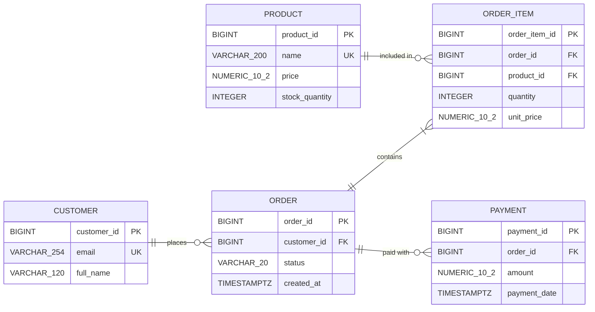

# E-commerce Platform ER Diagram

## Key and Relationship Notation Explanation

The Entity-Relationship (ER) diagram uses standard database notation to represent tables, key constraints, and visual structural links:

- **PK (Primary Key):** A unique identifier for every individual record in a table (e.g., `customer_id` uniquely identifies each customer).
- **FK (Foreign Key):** A field referencing the Primary Key of another table to create a link between them (e.g., `customer_id` in `ORDER` references `customer_id` in `CUSTOMER`).
- **UK (Unique Key):** A constraint ensuring no two rows contain identical values in specified columns (e.g., `email` in `CUSTOMER` and `name` in `PRODUCT`).
- **`||--o{` (Exactly one to zero or many):** One record on the left relates to zero, one, or multiple records on the right. For example, a single `CUSTOMER` can place zero or many `ORDER` records, but each `ORDER` connects back to exactly one `CUSTOMER`.
- **`||--|{` (Exactly one to one or many):** One record on the left relates to at least one or more records on the right. An `ORDER` must contain one or many `ORDER_ITEM` line items.
- **`||--o{` (Zero or many linkage):** A `PRODUCT` can be present in zero or many `ORDER_ITEM` rows, while an `ORDER` can have zero or many `PAYMENT` attempts recorded against it.

### Case Study Example
When customer Jane places an order (Order 101) for 2 Wireless Mice and 1 Keyboard, Order 101 acts as the parent record. It links to two separate rows in `ORDER_ITEM`: one referencing the `product_id` for Wireless Mouse with a quantity of 2, and another referencing the `product_id` for Keyboard with a quantity of 1.

## Required vs. Optional Fields
All attributes across all five entities are **required** (`NOT NULL`). No fields are optional in this database design. Every record must contain complete identifying and functional information upon creation.

## Rules Requiring Additional Constraints and Logic
Primary and Foreign Keys alone cannot enforce all business logic rules. The following rules require database-level constraints or application transaction logic:

1. **Range and Value Checks (`CHECK` constraints):**
   - `PRODUCT.price >= 0` and `PRODUCT.stock_quantity >= 0`
   - `ORDER_ITEM.quantity > 0` and `ORDER_ITEM.unit_price >= 0`
   - `ORDER.status` limited strictly to `'Pending'`, `'Processing'`, `'Shipped'`, `'Delivered'`, or `'Cancelled'`

2. **Transaction Logic and Verification:**
   - **Rule 7 (Stock Management):** Verifying that sufficient stock exists (`stock_quantity >= requested quantity`) prior to placing an order, as well as atomically decrementing inventory levels upon order placement, requires database transaction logic or application workflows.
   - **Rule 8 (State Transitions):** Blocking invalid state transitions (such as re-processing or shipping a `Delivered` or `Cancelled` order) requires application logic to evaluate current status before applying updates.
   - **Order Line Items:** Application logic enforces that an `ORDER` cannot be created without at least one accompanying `ORDER_ITEM`.
